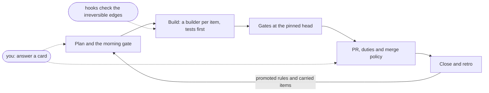

<p align="center"><picture>
    <source media="(prefers-color-scheme: dark)" srcset="docs/site/assets/hero-dark.svg">
    <source media="(prefers-color-scheme: light)" srcset="docs/site/assets/hero-light.svg">
    
</picture></p>

<h1 align="center">WUWEI 无为</h1>

<p align="center"><strong>Autonomous delivery where the safe path is the default one.</strong></p>

<p align="center">无为 (wuwei, said woo-way) means "effortless action": work gets done without forcing it.</p>

<p align="center"><a href="docs/site/index.md">Documentation</a> · <a href="docs/site/concepts.md">Concepts</a> · <a href="docs/site/configuration.md">Configuration</a> · <a href="LICENSE">Apache 2.0</a></p>

## What WUWEI is

WUWEI is a Claude Code plugin. It runs a chartered team of agents across your repositories
the way a careful engineering team works. You approve the plan each morning. An agent that
did not write a change reviews it, merges follow your merge policy, and a retro at close
proposes changes to the rules. Workspace memory lives under `.wuwei/`. The code host is
GitHub through `gh`, and tracker and chat are optional adapters.

WUWEI is not a hosted service, a tracker, a chat system, or a replacement for your
repository rules.

## The loop



`bin/wuwei next` derives the day from the plan, the event log, the worktrees, the verdict
files, one cached PR list and the seat ledger. It returns every ready launch, every due duty
and at most one decision for you. That decision is the morning gate, a spent round cap, a
PARK or ESCALATE verdict, or a merge the policy leaves to you. Claude walks what `next` returns.

A seat launches only from a brief logged at an unchanged head. Gates read the pinned head,
fix rounds are bounded, and a spec comes before gates for any tier above light. `pr raise --item`
runs only after every gate passes at head. The hooks refuse the irreversible edges by exact
argv: a default-branch update, merge, approve, admin, force push, deploy and an outward send
outside `outward.allow`. Outward steps are duties: `next` lists each one, `duty` records it,
and `close` waits for them. A skipped duty is recorded and listed in the report.

You answer in the session, on a card. A command that needs you prints its Owner step card,
and on your Yes the same command runs again. The morning gate is the other card. Nothing asks
you to type anything outside the session.

## The 20 commands

| Command | What it does |
| --- | --- |
| `init` | Create a workspace; `--upgrade` updates one after a plugin upgrade |
| `config` | `check`, `show`, `set`, `add-repo` and `promote` (the calibration proposal) |
| `doctor` | Find install, host, workspace and guard problems; `--fix` applies the fixes |
| `why` | Explain from records why an item or a refusal happened |
| `next` | The board: every ready launch, due duty and the one decision for you |
| `plan` | `propose`, `gate`, `approve`, `add`, `carry`, `park`, `resume` and the lead template |
| `seat` | `brief`, `note --fix`, `start` and `stop` a seat |
| `build` | `next` and `check` for the builder loop, `analysis` and `classes` |
| `dispatch` | `next`, `receive`, `opinion` and `polish` for the gates |
| `worktree` | `add` or `adopt` the item's worktree |
| `pr` | `raise`, `claim`, `ping`, `state` and `act` on owned PRs |
| `merge` | Check or merge an eligible PR under the merge policy |
| `duty` | Record an outward duty `next` listed as done or skipped |
| `tracker` | `create`, `log` and `move` the item's ticket |
| `close` | Close the day once every item, duty and the steward review have landed |
| `report` | The day report; `--week` prints a week's telemetry aggregate |
| `retro` | Compile the steward retro; `--promote` lands its charter proposals |
| `telemetry` | `preview`, `send` or `off` |
| `dora` | The DORA four keys with their sources |
| `agents` | `build` or `check` the generated role agents |

`hook <event>` (for the Claude Code hooks) and `status --line` (the status line) are plumbing.
The [operator reference](docs/site/reference.md) covers every flag.

## Install

You need Claude Code, Python 3.11 or newer, Git and `ssh-keygen`. Install the signed
`wuwei.tar.gz` release asset. From the project directory that will own the workspace:

```sh
curl -fL https://github.com/taoq-ai/wuwei/releases/latest/download/wuwei.tar.gz -o ../wuwei.tar.gz
mkdir -p ../wuwei-plugin
tar -xzf ../wuwei.tar.gz -C ../wuwei-plugin --strip-components=1
```

Use a fresh extraction directory. The archive includes `MANIFEST.sha256` and its
signature; GitHub's automatic source archives do not. In Claude Code, register the
extracted plugin:

```text
/plugin marketplace add ../wuwei-plugin
/plugin install wuwei@wuwei
```

The plugin needs no Python package install. Optional adapters need their own tools or
credentials. See [integrity](docs/site/integrity.md) for signature verification and key pinning.

Create the workspace:

```sh
../wuwei-plugin/bin/wuwei init --shadow
```

`--shadow` sets `guards.enforce = false` for your first week, so the guards log what they
would refuse and let the call through. `init` ends by checking the installation: an intact
signed release prints `plugin integrity: clean`. Then open Claude Code in the project
directory. The planner adds each repository with `wuwei config add-repo` and runs
`wuwei config promote`, which proposes each repository's checks and deploy signals. Each
asks its Owner step card, and nothing is written before your Yes.

`bin/wuwei doctor` prints one row per check, with the fix for anything that is not ok.
Run `/wuwei plan` to start the day ([daily path](docs/site/daily.md)). Use `bin/wuwei` or
`python3 -P -m wuwei` for CLI calls; plain `python3 -m wuwei` can import a same-named
directory in the current working directory.

Codex can run seats as an optional runtime: set `adapters.runtime = "codex"` and
`codex.command` ([configuration](docs/site/configuration.md)). A Codex plugin that runs the
guards inside Codex sessions is planned ([Codex spike](docs/specs/2026-09-30-codex-plugin-spike.md)).

## Upgrade

After a plugin upgrade, preview, then apply:

```sh
bin/wuwei init --upgrade --dry-run
bin/wuwei init --upgrade
```

The upgrade removes every retired config key and every file under `.wuwei/` that no code
reads any more, plus generated skills and agents the plugin no longer ships. It prints one
`Upgraded ...: remove ... (no longer read)` line per removal, or `Would upgrade ...` under
`--dry-run`. It never follows a symlink and never touches `days/`, which is history.

### Development installs

`/plugin marketplace add taoq-ai/wuwei` followed by `/plugin install wuwei@wuwei` uses the
marketplace's `./` development source. A source checkout is also a development install.
Use that checkout's `bin/wuwei` to run `init .`, then run
`bin/wuwei doctor --fix --apply integrity-reconfirm` and answer its Owner step card after
reviewing the checkout. Reconfirmation pins the content, HEAD commit and clean tree once per
commit. After a pull moves HEAD, reconfirm the new clean commit. Prefer the signed release
for normal installation.

## When something goes wrong

- `bin/wuwei why last refusal` names the guard, the rule and the fix for the last refused call.
- `bin/wuwei doctor --fix` checks the install, host, workspace and day and applies the deterministic fixes.
- `bin/wuwei next` prints where the day stands.
- The day's records are under `.wuwei/days/<date>/` ([recovery](docs/site/recovery.md)).

What the guards cover, and what they leave to the code host, is in
[security](docs/site/security.md).

## What is inside

- Skills: [wuwei-plan](skills/wuwei-plan/SKILL.md), [wuwei-report](skills/wuwei-report/SKILL.md) and [wuwei-retro](skills/wuwei-retro/SKILL.md).
- Seats, each with its charter: [planner](charters/planner.md), [lead](charters/lead.md), [builder](charters/builder.md), [shepherd](charters/shepherd.md), [steward](charters/steward.md) and four sentinels: [architecture](charters/sentinel-arch.md), [goal](charters/sentinel-goal.md), [quality](charters/sentinel-quality.md) and [security](charters/sentinel-security.md).
- Hooks: PreToolUse checks a call before it runs. PostToolUse traces each call and lints gate verdicts. SubagentStop checks each seat's verdict and retro note. SessionStart prints the orientation, goals and memory, and warns on integrity.
- Adapters by port ([adapters and ports](docs/site/adapters.md)).

## Limits

- WUWEI needs Claude Code. Codex can run seats as an optional runtime.
- One owner per workspace.
- Hooks add about 40 to 100 ms to each tool call, depending on the machine.
- It is early. So far only its author has used it day to day, and the
  [live rehearsal](docs/site/rehearsal.md) is the check before each release.

## Development

Run the test suite with Python 3.11 or newer and pytest:

```sh
python3 -m pytest -q
```

Skill routing cases under `evals/` are checked for structure by pytest without network
access. To measure the live triggering rate, install Claude Code, set
`ANTHROPIC_API_KEY` in your environment, then run:

```sh
claude plugin eval . --trust-plugin --ablation none --threshold 0.9 --json skill-evals.json
```

The runner exits 1 if any case scores below 0.9 (default 3 runs per case, so each case
must pass every run). It exits 2 if authentication or a cost limit prevents a complete run.
The `skill-evals` CI job runs on pushes to main when `ANTHROPIC_API_KEY` is set as a GitHub
Actions secret; until then the job prints a skip message.

See the [design](docs/specs/2026-09-24-wuwei-design.md) and [NOTICE](NOTICE). The
[contributing guide](https://github.com/taoq-ai/wuwei/blob/main/CONTRIBUTING.md) covers how
changes are made. Report vulnerabilities as described in [SECURITY.md](SECURITY.md).

## Acknowledgements

WUWEI builds on the projects below. [NOTICE](NOTICE) has the licence of each.

- [GitHub Spec Kit](https://github.com/github/spec-kit): the vendored `.specify/` files and `speckit-*` skills (MIT).
- [Simple Icons](https://github.com/simple-icons/simple-icons): the tool glyphs in the hero (CC0).
- superpowers: the shape of this README's sections (MIT, structure only).
- [OpenSpec](https://github.com/Fission-AI/OpenSpec): the `openspec` spec engine option (MIT, run as an external tool).
- autoharness: propose then promote, the ledger and the adherence lifecycle (MIT, ideas only).
- ralph-starter: the builder loop with backpressure and stuck detection (MIT, ideas only).
- humanizer: the writing checklist in the charters (MIT, paraphrased), based on [Wikipedia: Signs of AI writing](https://en.wikipedia.org/wiki/Wikipedia:Signs_of_AI_writing).
- [release-please](https://github.com/googleapis/release-please): release automation in CI (Apache-2.0).
- [ZIRAN](https://github.com/taoq-ai/ziran): the role grant audit in CI (Apache-2.0).
- WSJF and RICE: the two ranking frameworks.
- One-way and two-way doors: the decision framework.
- Verifiably Safe Autonomous Decision-Making (vGOAL), KU Leuven: a table of safety properties, each with its own test.
