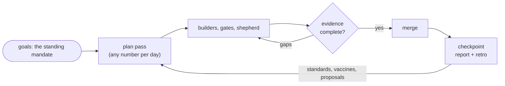

# The day

## Goals are the mandate

Your goals live in `.wuwei/goals.md`: outcome, measure, target, date and priority. They are the
standing mandate. Work inside them starts without asking you; work outside them is one `scope:`
question.

**Why:** approving every day's plan is a step the process can take for you once the direction is
clear. What you own is the direction.

## Plan passes

A plan pass (`/wuwei-plan`) adds, drops or re-ranks items in `.wuwei/plan.json`. Run it as often as
the day needs: in the morning, when the queue runs dry, when you add something, when priorities
shift. The plan is a running queue that carries across days, not a daily document.

The lead does the thinking in a pass. It reads every source it can reach (issues, red checks,
review threads, follow-ups, regressions), returns only ready candidates (a promise, acceptance
scenarios, the repository and files), and red-teams the plan: it names the riskiest item and the
cheapest way to learn early whether it works, and ranks that learning first.

**Why:** days change. A plan you can only make once goes stale by lunch, and a team that cannot
re-plan either stalls or improvises.

## Ranking

The configured framework ranks the queue, never a hand order.

- **WSJF** (default): value to the goal, time criticality, risk reduction, each on 1, 2, 3, 5, 8,
  13, 20, divided by job size.
- **RICE**: reach times impact times confidence, divided by effort.

Every score carries one line of evidence. **Why:** a ranking you can read the reasons for is a
ranking you can correct.

## Checkpoints

A close (`/wuwei-close`) writes the report for the day so far and launches the steward for the
retro. It locks nothing: the next plan pass reopens the day. A second checkpoint starts with what
changed since the first. There is no end time.

**Why:** you stop when you stop. A checkpoint gives you the picture whenever you want it without
pretending the day has a fixed shape.

## Tiers

Each item has a tier that sets how much evidence it needs:

| Tier | For | Gates |
| --- | --- | --- |
| light | a trivial, local change | quality |
| standard | the default | arch, quality, security |
| full | contracts, schemas, boundaries, auth, secrets, agent tooling, infrastructure | arch, quality, security, goal |

When unsure, the lead goes up. A repository over its [error budget](learning.md#error-budget) raises
every tier one step.
