# WUWEI 无为

<picture>
  <source media="(prefers-color-scheme: dark)" srcset="assets/hero-dark.svg">
  
</picture>

**Responsible autonomy for agent teams.** Your agents plan, build, review and ship. WUWEI audits
the evidence, holds the few doors that do not reopen, and asks you only what is yours.

无为 (wuwei, said woo-way) means "effortless action": work gets done without forcing it.

## The problem it solves

Agents are fast, tireless and literal. They take the shortest path to "done": a merge without the
test, a review skipped, a force push to make a conflict go away. They also ask too much: should I
continue, which name do you prefer, may I run the tests. Both cost you. The first costs quality,
the second costs your attention.

Adding process usually makes it worse. A process the model cannot see the point of is a process
it routes around, and every rule you add to catch a workaround creates the next one.

## The idea

WUWEI does not prescribe steps. It describes what done looks like, reads the artifacts the work
leaves behind (commits, pull requests, verdicts, CI), and says what is missing. The model chooses
how to get there with its own tools.

Around that it adds three things:

- **Teaching at the moment.** Hooks bring the right standard when it matters: the PR template
  before a PR opens, the verdict format when a review comes back malformed.
- **A few doors.** A short, closed list of refusals for what cannot be taken back. Everything else
  passes and is recorded.
- **A learning loop.** Each checkpoint's retro turns what escaped into standards, retires rules
  that never catch anything, and proposes memory and skills for your repositories.

## Where to go next

- [Getting started](getting-started.md): install and run your first day.
- [Concepts](concepts/index.md): every idea in WUWEI, why it is there, and where it lives.
- [Reference](reference.md): commands, configuration, files and formats.
